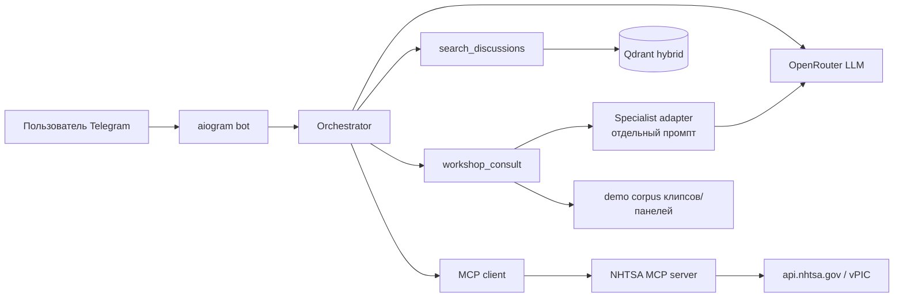
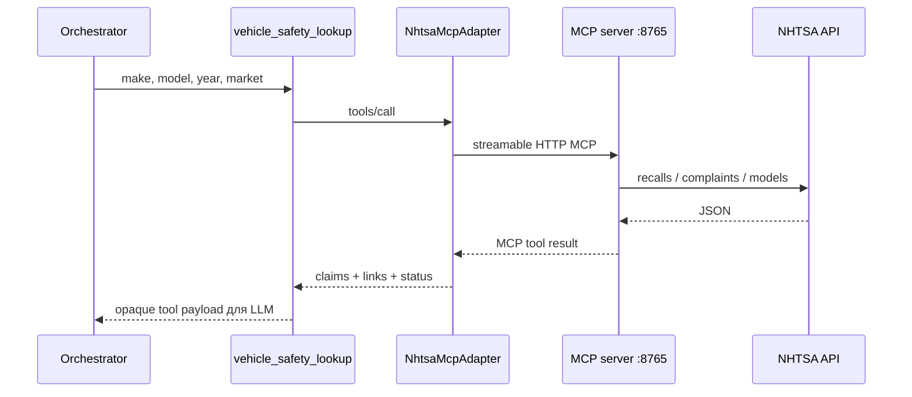

# АвтоНапарник

Русскоязычный Telegram-консультант автовладельца и механика: от симптома и известной машины — к проверенным фактам NHTSA, обсуждениям механиков и сборочным проверкам без ложного диагноза.

**Интерфейс:** [@autolover_test_bot](https://t.me/autolover_test_bot)  
**Презентация (GitHub Pages):** https://schaft-s.github.io/project_auto_helper/  
**Исходник слайдов:** [presentation/index.html](presentation/index.html)  
**Спецификация продукта (проектный пакет):** `autonaparnik_agent_plan_v2/`

---

## 1. Задача

Помочь автовладельцу или механику перейти от неясного симптома к обоснованному следующему действию:

- понять, что нашлось по отзывам и жалобам NHTSA;
- посмотреть похожий опыт на Mechanics Stack Exchange / учебные тексты;
- получить ориентиры по сборке/разборке неответственных узлов (клипсы, панели, фары);
- не принять консультацию за дистанционный диагноз и не подменить автомобиль «похожей» моделью.

Система **не** обещает вероятность поломки, проверку VIN, подбор запчастей или заводскую карту на любую марку.

## 2. Пользователь и сценарии

| Пользователь | Сценарий |
|---|---|
| Автовладелец (`/mode owner`) | «Toyota Camry 2015, есть ли отзывы NHTSA?» — факты кампаний/жалоб, рынок США явно указан |
| Автовладелец | «Свистит на прогреве» после того, как назвал машину — обсуждения + уточнения, без workshop |
| Механик / familiar (`/mode mechanic`) | «После установки панели дребезг — что проверить?» — вызов сборочного специалиста |
| Любой | Смена машины в диалоге («была Audi, нет — Civic») — контекст не смешивается |
| Любой | «спасибо» / «ок» — короткий ответ без повторного поиска |

Марка, модель и год извлекаются из текста диалога; отдельной формы `/car` нет.

## 3. Границы MVP и критерии готовности

**Входит**

- Telegram-бот (aiogram 3), команды `/start`, `/help`, `/reset`, `/mode`
- Оркестратор с tool-calling через OpenRouter
- MCP-сервер NHTSA (3 инструмента) + клиент по протоколу MCP
- Гибридный RAG (Qdrant dense+BM25) по Mechanics SE и BCcampus
- Сборочный specialist: отдельный вызов LLM с отдельным промптом и JSON-контрактом
- Политика риска (SRS/HV → caution, без пошаговых инструкций)
- Offline-тесты + live Eval (маршруты, multi-turn, смена контекста)
- Публичная демонстрация через Telegram

**Не входит (осознанно)**

- Web UI / личный кабинет
- Дообученная локальная модель специалиста (SFT/DPO) — *планируется заменить текущий specialist на дообученную модель специалиста по сборке; сейчас — специализированная модель API с отдельным промптом*
- Диагностика по фото/звуку, продажа запчастей, произвольный веб-поиск
- Подмена автомобиля похожей моделью при пустом NHTSA

**Критерии готовности MVP**

1. По ссылке на бота проходит сценарий NHTSA с реальным MCP-вызовом.
2. По симптому вызывается RAG; в ответе есть ссылка на источник.
3. По сборочному вопросу вызывается specialist; шаги не выдумываются как заводская карта.
4. Смена машины и нейтральные реплики покрыты multi-turn тестами.
5. README позволяет воспроизвести стек локально.

## 4. Архитектурная схема



Один оркестратор, три инструмента. Specialist — не отдельный MCP и не локальный checkpoint; это второй вызов той же API-модели с `prompts/specialist.v2.md` и строгим JSON.

## 5. Схема MCP-интеграции

Решение зафиксировано в `docs/decisions/M0-mvp.md`.



| Слой | Реализация |
|---|---|
| Сервер | `python -m autonaparnik.mcp_server` (FastMCP, streamable HTTP) |
| Инструменты | `nhtsa_search_recalls`, `nhtsa_search_complaints`, `nhtsa_lookup_vehicles` |
| Клиент | `autonaparnik/adapters/nhtsa.py` — только MCP, без прямого REST из фасада |
| URL по умолчанию | `http://127.0.0.1:8765/mcp` |
| Compose | сервис `nhtsa-mcp` в `infra/docker-compose.yml` |

Имена инструментов совместимы с кандидатом cyanheads; в MVP используется собственный минимальный Python-сервер для воспроизводимого локального запуска.

## 6. AI-логика

### Оркестратор

- Модель: `deepseek/deepseek-v4.1-flash-1017` через OpenRouter (см. выбор моделей ниже)
- Промпт: `prompts/orchestrator.v2.md`
- Tools: `vehicle_safety_lookup`, `search_discussions`, `workshop_consult`
- Итог пользователю — JSON с полем `telegram_html` (готовое сообщение, не черновик)

### Specialist (сборка)

Это **не отдельная ветка диалога** в Telegram. Пользователь пишет одному боту; оркестратор при необходимости вызывает tool `workshop_consult`, внутри которого идёт **второй LLM-вызов** (`SpecialistAdapter` + `prompts/specialist.v2.md`). Результат возвращается в оркестратор как structured `SpecialistResult` / opaque tool payload; в чат уходит уже собранный ответ (summary + блок проверок в `render_answer`), а не отдельный «чат со специалистом».

- Сейчас: **специализированная модель с отдельным промптом** — тот же OpenRouter-endpoint, отдельный вызов и JSON-контракт
- **Планируется заменить на дообученную модель специалиста по сборке** (локальный checkpoint + SFT); датасет КСО и training pipeline в этом MVP не развёрнуты
- Получает только RAG/demo evidence по клипсам/панелям; форумные ответы в его контекст не смешиваются
- Цитаты ограничены `evidence_id` / `EASSUME`; оркестратор не переписывает шаги specialist в tool-message

### RAG

- Mechanics Stack Exchange (CC BY-SA) + BCcampus Trades Access (CC BY 4.0)
- Qdrant hybrid: dense `paraphrase-multilingual-MiniLM-L12-v2` + sparse BM25, fusion RRF
- Fallback на лексический поиск, если Qdrant недоступен

### Выбор модели OpenRouter (эксперимент)

Скрипт: `scripts/model_bakeoff.py`. Отчёт: `evaluation/model-bakeoff-report.json`.

Фиксированный harness из **10** маршрутных кейсов (NHTSA US/RU, Chery без подмены, discussions, workshop, safety, general) прогнан на пяти моделях:

| Модель | Pass | Avg latency |
|---|---:|---:|
| `google/gemini-2.5-flash` | 10/10 | 4.3 s |
| `openai/gpt-4o-mini` | 10/10 | 6.7 s |
| `deepseek/deepseek-v4.1-flash-1017` | 10/10 | 14.2 s |
| `anthropic/claude-haiku-4.5` | 9/10 | 9.4 s |
| `meta-llama/llama-3.3-70b-instruct` | 6/10 | 13.5 s |

**Выбор production:** DeepSeek Flash. На нём итеративно отлажены промпты и полный multi-turn dialog suite (контекст, смена машины, «спасибо» без повторного поиска). Gemini — лидер по задержке среди идеальных 10/10; переход возможен после повторного dialog eval.  
**Ошибки кандидатов:** Claude один раз не вызвал NHTSA на RU-рынке; Llama передаёт `model_year` строкой → падение валидации tool args.

## 7. Запуск и развёртывание

Нужен Python 3.11+ (проверено на 3.12), Docker (Qdrant + MCP), ключи OpenRouter и Telegram.

```bash
python3 -m venv .venv
source .venv/bin/activate
pip install -e ".[dev,data]"
cp .env.example .env
```

`.env`:

```
OPENROUTER_API_KEY=...
TELEGRAM_BOT_TOKEN=...
OPENROUTER_MODEL=deepseek/deepseek-v4.1-flash-1017
MCP_URL=http://127.0.0.1:8765/mcp
QDRANT_URL=http://127.0.0.1:6333
```

Инфраструктура и индекс:

```bash
docker compose -f infra/docker-compose.yml up --build -d
python scripts/prepare_mechanics.py
python scripts/prepare_bccampus.py
python scripts/ingest_qdrant.py
```

Если MCP не из compose: `python -m autonaparnik.mcp_server`.

Бот: `python -m autonaparnik.bot.main` → открыть [@autolover_test_bot](https://t.me/autolover_test_bot).

Smoke:

```bash
python -m autonaparnik.smoke mcp
python -m autonaparnik.smoke router
```

## 8. Тесты и Eval

### Offline (без сети к LLM)

```bash
pytest --ignore=tests/test_consult_live.py --ignore=tests/test_consult_dialogs.py
```

**60 passed** — контракты, policy, retrieval, MCP row-parsing, orchestrator (история, нейтральные реплики, opaque workshop payload, дедуп вопросов), specialist JSON, bot render/native UX.

### Live consult (одиночные маршруты)

```bash
AUTONAPARNIK_LIVE=1 pytest tests/test_consult_live.py
# или harness:
PYTHONPATH=. python - <<'PY'
# см. evaluation/consult-live-report.json
PY
```

Отчёт `evaluation/consult-live-report.json`: **34/34 pass**  
Группы: NHTSA (в т.ч. RU-рынок и запрет подмены Chery/Lada), discussions, workshop, combined, general, safety.

### Multi-turn диалоги (контекст и смена контекста)

Отчёт `evaluation/consult-dialogs-report.json`: **13/13 pass**

Покрыто явно:

| Сценарий | Что проверяется |
|---|---|
| `hello-bmw7-whistle` | привет → машина → симптом без лишних tool |
| `camry-consumption-thanks` / `clip-then-thanks` / `ok-after-help` | «спасибо»/«ок» без повторного поиска |
| `knock-then-discovery` | симптом раньше марки |
| `overheat-followup-traffic` | уточнение «в пробке» без повторного приветствия |
| `bmw7-then-headlight-workshop` / `camry-then-door-card-workshop` | specialist видит машину из истории |
| `switch-car-then-panel-workshop` | смена Audi → Civic: в specialist Civic, не Audi |
| `workshop-followup-same-car` / `pronoun-this-car-workshop` | follow-up и «эта машина» без переспроса марки |
| `symptom-then-assembly-switch` | смена типа задачи при той же машине |
| `bmw3-ignition-angle` | длинный диалог без сырых Complaint-заголовков |

### Visibility harness

`tests/consult_harness.py` проверяет не только «tool вызван», но и что payload **дошёл до модели** (`see_lookup` / `see_discussions` / `see_workshop`) и что факты использованы в ответе (`use_*`).

### Разбор ошибок

| Наблюдение | Причина | Что сделано / статус |
|---|---|---|
| Ранее `disc-multimeter-manual` падал на use_discussions | Модель игнорировала excerpt BCcampus | Промпт + harness; в актуальном прогоне **pass** |
| Ранее `overheat-followup-traffic` — summary > 1800 | Длинный follow-up | Лимит ослаблен до 2000; **pass** |
| Llama в bake-off | `model_year` как string | Зафиксировано как риск слабого schema-following; модель не выбрана |
| Claude Haiku | Пропуск lookup на RU Camry | Не выбран в production |
| Пустой NHTSA (Chery/Lada) | Данных нет | Система **не** подменяет машину; сообщает статус |
| Workshop без заводской карты | Демо-корпус клипсов | Specialist помечает general/EASSUME; не выдаёт выдуманную OEM-процедуру |
| NHTSA для RU-владельца | База только US | В ответе явно рынок США |

Golden offline: `evaluation/golden.jsonl` (50 кейсов; `python -m autonaparnik.eval_golden`). Live golden: `--live` при поднятом MCP и ключе.

Bake-off: `PYTHONPATH=. python scripts/model_bakeoff.py`.

## 9. Источники

1. [NHTSA Recalls / Complaints API](https://www.nhtsa.gov/nhtsa-datasets-and-apis) — отзывы и жалобы (рынок США).  
2. [vPIC](https://vpic.nhtsa.dot.gov/) — справочник моделей.  
3. [HuggingFaceH4/stack-exchange-preferences](https://huggingface.co/datasets/HuggingFaceH4/stack-exchange-preferences) — Mechanics SE, CC BY-SA.  
4. BCcampus / Camosun Trades Access Common Core — учебные тексты, CC BY 4.0 (`data/bccampus/`).  
5. [OpenRouter](https://openrouter.ai/) — доступ к LLM.  
6. [Model Context Protocol](https://modelcontextprotocol.io/) — протокол MCP.  
7. ADR проекта: `docs/decisions/M0-mvp.md`, `M1-mechanics-rag.md`, `M2-hybrid-rag.md`.  
8. Продуктовая спецификация: `autonaparnik_agent_plan_v2/`.

## 10. Ограничения текущего этапа (честно)

- Specialist — специализированный API-вызов с отдельным промптом; **дообученной сборочной модели пока нет** (запланирована замена).
- История чата хранится в памяти процесса бота.
- NHTSA отражает рынок США.
- Форумные тексты — чужой опыт (CC BY-SA), не сервисная карта OEM.
- Web-интерфейс в MVP не реализован; точка входа — Telegram.
