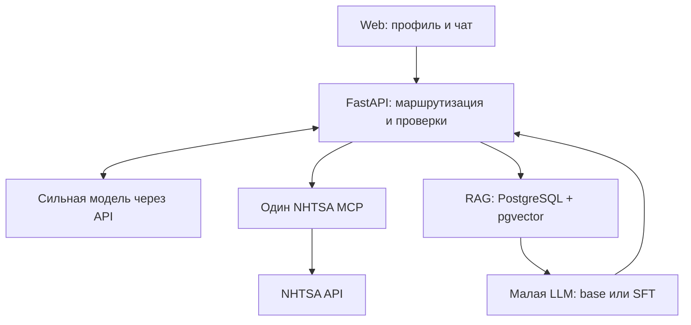

# Минимальная архитектура

Статус: проектное решение для реализации. Точные совместимые версии фиксируются по M0, а не берутся независимо как latest.

## 1. Состав

Стрелка RAG → LLM означает передачу контекста кодом backend. База данных сама модель не вызывает. RAG и малая модель — внутренние части workshop_consult. MCP нужен для NHTSA; дополнительные MCP для PostgreSQL и локального inference не требуются.

| Часть | Выбор | Зачем / ограничение |
|---|---|---|
| Интерфейс | React + TypeScript + Vite, один экран | После build статические файлы отдаёт тот же backend; нет SSR и отдельного production Node-сервера |
| Backend | FastAPI + Pydantic + SQLAlchemy/Alembic | Явные контракты, адаптеры, простой async request |
| Оркестратор | Одна сильная tool-capable модель через OpenRouter; кандидат anthropic/claude-sonnet-4.5 | OpenRouter — транспортный кандидат. Не использовать auto-routing разных моделей в сравнении |
| NHTSA | Готовый сервер cyanheads, private Streamable HTTP | Официальный Python MCP SDK на стороне клиента; version pin после smoke |
| RAG | PostgreSQL + pgvector, exact dense search | Одна БД, применимость до retrieval; без отдельного векторного сервиса |
| Embeddings | intfloat/multilingual-e5-base | Предварительный RU/EN baseline, 768 измерений; оценить на реальном корпусе |
| Специалист | Qwen/Qwen3-4B-Instruct-2507 | Один checkpoint для base и SFT; размер/лицензия подтверждены, профильное качество ещё нет |
| Serving | vLLM на доступном NVIDIA GPU | Один приватный inference endpoint. Transformers + PEFT допустим как временный pilot backend |
| Обучение | Transformers, PEFT, TRL; SFT/QLoRA | Отдельная среда и lock; обучение не входит в зависимости API |
| Развёртывание | Docker Compose + HTTPS reverse proxy | CPU-часть и при необходимости отдельный GPU-узел |

Связанные первичные документы: [OpenRouter tool calling](https://openrouter.ai/docs/guides/features/tool-calling), [pgvector](https://github.com/pgvector/pgvector), [E5 model card](https://huggingface.co/intfloat/multilingual-e5-base), [vLLM](https://docs.vllm.ai/en/stable/serving/online_serving/). Эти ссылки подтверждают возможности компонентов, а не совместимость уже собранного проекта.

## 2. Почему без worker

MVP обслуживает небольшую демонстрационную нагрузку. Обычный async POST ждёт ограниченное по времени выполнение и возвращает готовый JSON. Внутри процесса — семафор на 1–2 активных обращения, таймауты и управляемая ошибка занятости. Рестарт прерывает запрос; UI предлагает повторить. Никаких обещаний автоматического возобновления незаконченной цепочки.

Один процесс приложения означает, что лимиты в памяти действуют для этого процесса. Не масштабировать число workers, пока лимиты/кэш не вынесены согласованно. Для CPU embeddings использовать ограниченный executor, чтобы не блокировать async loop. Если реальный p95 не укладывается в HTTP timeout хостинга, сначала уменьшить контекст/вызовы или изменить timeout. Worker добавляется лишь по отдельному ADR после измерения.

## 3. Два инструмента сильной модели

### vehicle_safety_lookup

Аргументы модели: symptom и include_complaints. Марка, модель, год и рынок берутся из подтверждённого профиля текущего обращения; модель не переопределяет их аргументами инструмента. Внутри — MCP-вызовы поиска кампаний и, при необходимости, жалоб. Нормализованные результаты с source IDs и охватом возвращаются оркестратору.

Lookup каталога может помочь уточнить имя. Он не должен незаметно менять автомобиль пользователя. Развёрнутая спецификация — [NHTSA](03-nhtsa-integration.md).

### workshop_consult

Аргументы модели: task, query, user_plan. Допустимые task: assembly_checklist, review_plan, post_repair_checks. Backend выполняет фильтр корпуса, поиск, сбор контекста, вызов малой модели и валидацию. Полученный SpecialistResult сохраняется в памяти текущего запроса, а в окончательный ответ прикрепляется кодом.

Аргументы query/user_plan от маршрутизатора служат подсказками; исходный пользовательский текст передаётся специалисту из ChatRequest и не заменяется скрытым пересказом. Backend возвращает сильной модели только непрозрачный block_id, статус и признак наличия проверок. Содержательные checks, технические excerpts и производные вопросы туда не отправляются даже при публичном показе; их прикрепляет backend к ответу. public_serve не подразумевает send_cloud.

Клиент и оркестратор не передают документам права, источник модели или флаг SFT. Источник этих метаданных — администраторский manifest и фактически загруженный checkpoint. Если пользователь выбрал профильный сценарий в UI или маршрутизатор классифицировал его как workshop, backend требует выполненный workshop_consult либо явное needs_context/out_of_scope/unavailable. Свободный ответ сильной модели без специалиста не засчитывается как профильная функция.

## 4. Порядок одного обращения

1. Проверить размер входа, допустимые роли истории, профиль и общий бюджет. История браузера — недоверенный текст. UI хранит assistant-карточки отдельно для отображения и сериализует в follow-up только пользовательские сообщения. Перед отправкой router backend повторно удаляет все assistant entries, даже если клиент их прислал. Технические блоки, excerpts и вопросы специалиста никогда автоматически не возвращаются в cloud через историю; при необходимости контекст запрашивается заново. Это контроль собственного потока данных, не обещание DLP для текста, вручную введённого пользователем. Нельзя принимать system/tool сообщения, прошлые source objects, URL для загрузки или готовые evidence IDs.
2. Определить необходимость уточнения. Если для NHTSA не хватает make/model/model_year, задать не более трёх вопросов. Маркет неизвестен — сохранить unknown и ограничение, не назначать US автоматически.
3. Первый вызов оркестратора получает пользовательский контекст и две схемы инструментов. Он может выбрать один или оба инструмента. Вызовы независимых направлений допускается исполнять параллельно.
4. Для workshop внутри одного вызова выполнить RAG → specialist. Контекст содержит только текущие разрешённые evidence, applicability и максимальный уровень детализации.
5. Валидировать SpecialistResult. Проверить схему, существование ссылок именно во входных evidence специалиста, ограничения применимости, допустимость выдачи и отсутствие новых неподтверждённых численных параметров. Наличие evidence ID не доказывает смысловую правильность — её проверяют отдельно по рубрике.
6. Второй вызов оркестратора объясняет NHTSA, формулирует краткий итог/уточнения. Он не редактирует checks специалиста и не добавляет новую ремонтную процедуру. При явном противоречии его текста техническому блоку выводить шаблонный нейтральный итог и исходный блок, а не «исправлять» незаметно одной моделью другую.
7. Backend собирает AnswerEnvelope с источниками, original specialist block, метаданными и частичными ошибками. UI отображает структурированные поля без raw HTML.

Свободная семантика summary всё равно требует проверки на наборе примеров: строгая JSON Schema не гарантирует отсутствие неправильного вывода. В workshop-only ответе финальный общий summary можно формировать шаблоном, чтобы не делать ненужный облачный вызов.

## 5. Начальные лимиты

Настройки являются проектными и хранятся в configs/runtime-policy.json. Они уточняются на pilot до замороженной оценки.

| Параметр | Начальное значение |
|---|---:|
| Общий deadline запроса | 90 секунд |
| Router calls | Обычно 2, максимум 3 вместе с исправлением формата |
| Specialist calls | 1, максимум 2 вместе с исправлением формата |
| Прикладные tool calls | Максимум по 1 реальному исполнению каждого из 2 tools; идентичный повтор — из памяти запроса |
| Физические MCP calls | Максимум 4 tool attempts, включая retries, lookup и страницы |
| Страницы жалоб | Максимум 2 по 20; сначала одна |
| Активные запросы приложения / specialist | 2 / 1 |
| RAG top-k | До 4 фрагментов с необходимым контекстом |
| Контекст специалиста | Первоначально 4096 токенов вместе с местом для ответа |
| Пользовательский текст | До 6000 символов |
| История | До 12 сообщений, до 30000 символов суммарно с текущим |

Начальные per-call caps: connect 5 с, router 25 с, specialist 35 с, MCP 10 с, retrieval 5 с. Ожидание семафора максимум 2 с и включено в deadline 90 с; при занятости вернуть 429. Каждый вызов получает min(per-call cap, оставшийся общий бюджет). Proxy timeout 100 с, browser timeout 105 с; это плановые значения для проверки на выбранном хостинге. При параллельных tools резервирование общей квоты MCP/LLM должно быть атомарным.

Не суммировать таймауты так, чтобы они превосходили общий deadline. Перед каждым сетевым вызовом считать оставшееся время. Одна retry временной ошибки допустима только в пределах общего бюджета. Нет бесконечного planner loop и скрытых платных ретраев.

Лимиты расходов задаются в аккаунте API и конфигурации сервиса. При исчерпании — понятная ошибка, без автоматической смены провайдера или снятия privacy-фильтров. Статус cache сопровождается возрастом данных; fixtures никогда не маркируются live.

## 6. RAG в минимальном варианте

Импорт только администратором из подготовленных MD/JSONL. Права и применимость задаются до индексации. Документы неизвестного происхождения не используются как точная инструкция.

Exact cosine search по отфильтрованным документам → top-k → добавление родительского предупреждения → token-budget. Для E5 использовать query:/passage: и собственный tokenizer; исходный лимит модели 512 токенов. Ориентир chunk 250–350 токенов, hard cap 480 с заголовком/префиксом. Разбиение не должно отрывать условие от действия.

Если по validation видно, что плохо находятся артикулы/термины, добавить PostgreSQL full-text и объединение рангов RRF. Это условное улучшение, не стартовый обязательный этап. HNSW, reranker и дополнительный поисковый сервис также не нужны без замеров. FTS PostgreSQL не следует называть BM25, если BM25 не реализован.

Применимость: matched — известные существенные поля совпали; general — проверенный переносимый принцип; unknown — данных недостаточно; mismatch — документ исключён. Косинусное сходство не может превратить mismatch в matched. Производственный контекст КСО требует отдельного решения о переносимости.

## 7. Хранение и API

Достаточно таблиц documents, chunks и небольшой таблицы обезличенных request_metrics. Диалоги, пользовательские тексты и исходные закрытые документы не нужны в operational logs. Кэш NHTSA первоначально ограниченный в памяти с TTL; перезапуск теряет кэш, но не данные корпуса. База воспроизводится из разрешённого manifest и импорта.

Публичные endpoints:

- POST /api/v1/chat — ChatRequest → AnswerEnvelope; 422 на некорректный вход, 429 на лимит, 503 на глобальную недоступность, 504 на общий deadline. Частичная недоступность инструмента возвращается с 200 и status=partial, если полезная часть ответа уже есть.
- GET /api/v1/health — минимальный статус процесса без секретов.
- GET /api/v1/ready — готовность обязательных configured компонентов без обращения к платному API на каждый health check.
- GET /api/v1/corpus/{document_id} — только материалы с public_serve; выдача текста/excerpts дополнительно требует publish_source, либо доступна только разрешённая карточка, идентификатор из опубликованного каталога. Никаких путей к произвольным файлам.

MCP, БД и vLLM не публикуются в интернет напрямую. В схеме contracts/api.schema.json описаны payloads, а не будто уже работающий сервер. OpenAPI для реальных маршрутов генерируется из FastAPI в T05 и проверяется при реализации; отдельного непроверенного OpenAPI YAML сейчас нет.

## 8. Модули будущего приложения

app/api, app/domain, app/orchestration, app/adapters/router, app/adapters/nhtsa, app/adapters/specialist, app/retrieval, app/policy. Рядом web, training, evaluation, infra. Это будущие каталоги кода, которых в пакете спецификации ещё нет.

Canonical contracts в этом пакете — contracts/models.py и экспортированные JSON Schema. Интегратор переносит их в реализацию либо меняет через согласованный ADR с синхронным обновлением примеров и потребителей. Shared schema/migrations меняет один владелец. Не дублировать разные версии SpecialistResult в ML и backend.

## 9. Публичные и закрытые данные

Default deployment использует только корпус и checkpoint с разрешением public_serve. Права train, retrieval, send_cloud, public_serve, publish_source, publish_weights различны. Если train разрешён, но public_serve нет, такой адаптер не включается в публичный MVP. Удаление оригинальной КСО из базы не снимает ограничений с обученной на ней модели.

Для закрытого локального эксперимента документы, targets и содержательные результаты специалиста не отправляются облачному оркестратору или облачным агентам без полномочий. На ранней стадии не строить сложный private/public портал: выбрать один разрешённый публичный набор, а закрытый эксперимент оформить отдельно лишь при необходимости курса.

[OpenRouter provider routing](https://openrouter.ai/docs/guides/routing/provider-selection) поддерживает фильтры параметров/обработки данных; они не являются разрешением владельца КСО на передачу. Политику приватности нельзя делегировать тексту LLM.

Общий token-инвариант serving: tokens(chat_template(prompt)) + max_new_tokens <= max_model_len. Для обучения полный prompt + target + template должен помещаться в max_seq_len. Если pilot выполнялся на 2048, запуск с 4096 отдельно проверяется; production не выходит за проверенную длину. Права в manifest могут быть разрешены до предметного review, но фактические import/train/serve требуют review_status=approved и соответствующего разрешения. При старте публичного inference проверяется public_serve всех источников training-manifest, связанного с реальным artifact_sha256.

Кандидат router `anthropic/claude-sonnet-4.5` присутствует в [каталоге OpenRouter](https://openrouter.ai/anthropic/claude-sonnet-4.5); это конкретная отправная точка, не заявление о лучшей/новейшей модели. M0 проверяет поддержку tools/response format у выбранного provider, latency и бюджет; затем фиксирует один model_id и provider.

Повтор app tool с другим набором аргументов в том же обращении не запускается: возвращается ограничение бюджета, новый поиск возможен следующим сообщением. Format repair специалиста выполняется внутри единственного workshop_consult и входит в отдельный лимит specialist_calls_max=2. MCP initialize/tools/list выполняются при подключении/старте; лимит4 относится к tools/call за пользовательский запрос, а не к числу протокольных handshake-пакетов. В live/public режиме provider_daily_spend_cap=null означает незавершённую конфигурацию: перед публикацией задать и проверить лимит расходов у провайдера/ключа и соответствующую конфигурацию. Нельзя трактовать null как безлимитный production.
